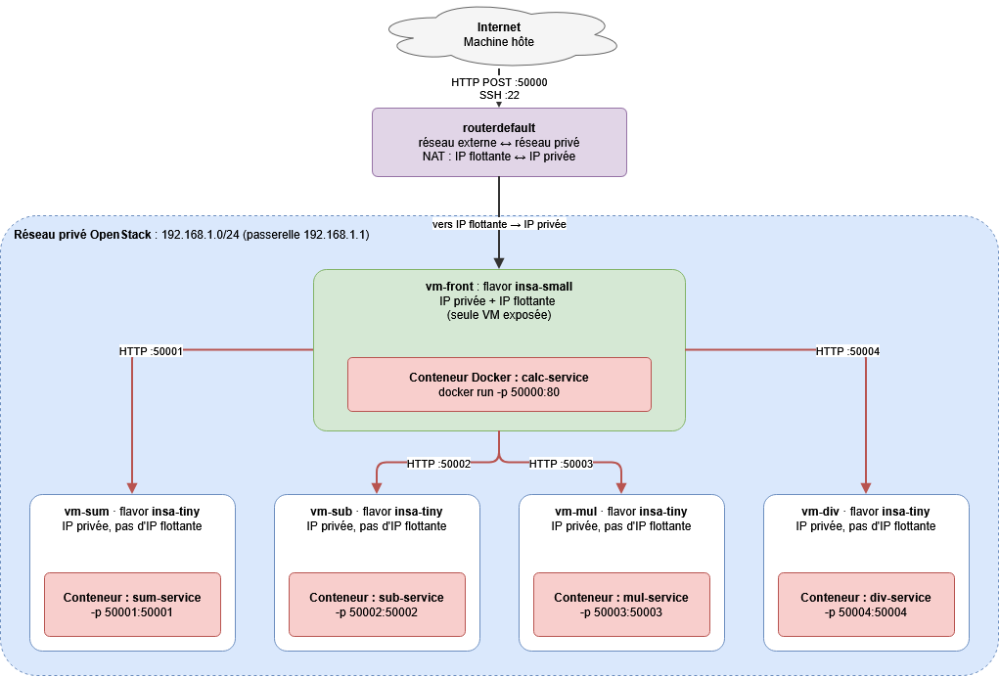

# TP3

## Etape 1

## Etape 2

1. Dans notre cas, *vm-front* est la seule VM connectée à Internet, elle sert de point d'entrée car c'est la seule avec une IP flottante qui reçoit les requêtes des utilisateurs sur le port 50000. Elle sert aussi d'orchestrateur pour les autres VMs, c'est elle qui va redistribuer l'opération à la bonne VM avec le bon service. Enfin, elle sert de Proxy Jump pour accéder via SSH aux VMs privées.

2. Cela sert par exemple en cas de panne, si une VM vient à tomber en panne, cela n'affecte pas les autres services (sauf si c'est notre seule VM exposée à Internet). Niveau sécurité, on a qu'une seule VM exposée, les autres restent privées donc il y a moins de failles potentielles. Au niveau des ressources, on a pu mettre une flavor sur chaque VM en fonction de son besoin (vm-front dispose de insa-small au lieu de insa-tiny car tout le flux passe par elle donc elle a en théorie besoin de plus de ressources).

## Etape 3

1. Pour les flux réseau on a besoin de :
     - Flux TCP sur le port 50000 pour permettre l'accès depuis l'extérieur à la calculatrice.
     - Un accès SSH, donc TCP port 22 pour l'admin. Toutes les VMs sont accessibles sur ce port.
     - Flux TCP personnalisé, flux "interne" qui permet de communiquer depuis la vm-front jusqu'aux autres VMs via les ports 50001..50004.
     - Enfin, un flux de sortie depuis toutes les VMs pour renvoyer les données.

2. Cela permet de réduire les failles potentielles niveau sécurité, on sait exactement sur quel port on autorise la communication, la surface d'attaque est extrêmement réduite.

3. Non, Docker compose ne gère qu'une seule machine, il lance les conteneurs uniquement sur la machine sur laquelle il est exécuté. Pour déployer sur plusieurs VMs, il faut qu'on utilise un orchestrateur style Kubernetes
